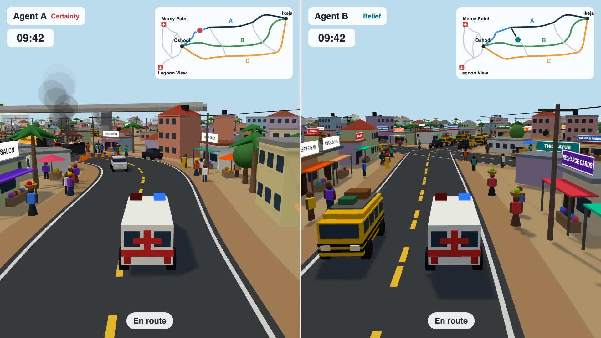
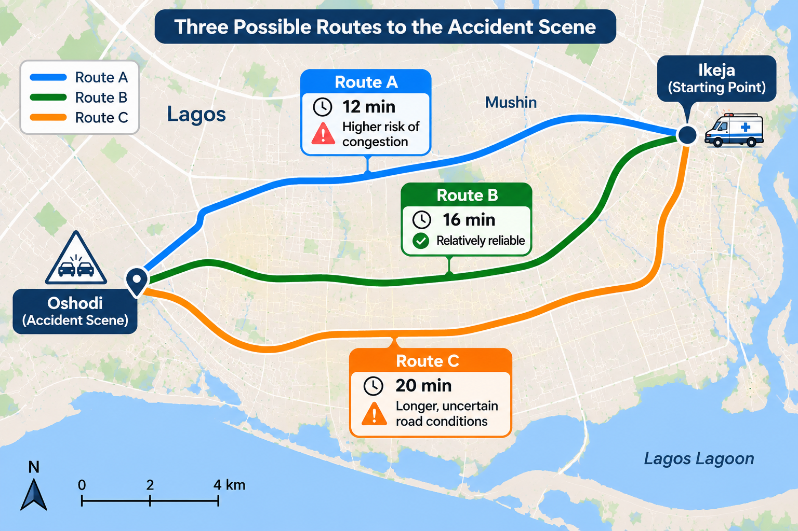
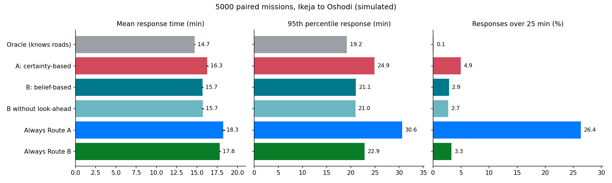

# Lagos-Autonomus-Ambulance
A simulation designed to explain how planning under uncertainty works. It features two agents, a certainty based agent and a belief based agent trying to run an emergency response to an accident victim in Oshodi while dodging traffic.

A stylised simulation. It uses no live traffic data or LASAMBUS records, the geography only loosely follows the map below, and the hospitals are fictional.





## Task
An ambulance drives from Ikeja to an accident at Oshodi, spends 3 minutes loading, then goes to the nearest available hospital (Mercy Point has a bed 70% of the time, confirmed by phone at pickup; otherwise Lagoon View).

- Routes A (12 min free-flow, jam and blockage prone), B (16 min, reliable), C (20 min, uncertain), joined by side streets.
- Each segment is secretly clear, congested or blocked (+14 min), fixed for the mission.
- At each junction both agents get a noisy report on every segment. Reports on adjacent segments are more accurate; 35% of distant blockages are reported as clear.

## Agents
- **A, certainty-based:** treats the latest report as true, takes the shortest path, replans at every junction.
- **B, belief-based:** Bayes filter per segment, then belief-space dynamic programming that averages over what the crew will see at later junctions, replanning at every junction.

Research basis: this is a Canadian Traveller Problem (Papadimitriou & Yannakakis, 1991) with noisy remote sensing, treated as a POMDP (Kaelbling et al., 1998). The belief update is Equation 2 of the blog and the planner applies Equation 3 over the next-junction observations. It is exact for those observations but does not anticipate future long-range reports, so it is not a full POMDP optimum. See also Eyerich, Keller & Helmert (2010) on planners for this problem family.

## Results (5000 paired missions)
| Agent | Mean response (min) | 95th percentile | Over 25 min | Mean to hospital (min) |
|---|---|---|---|---|
| Oracle (knows true roads) | 14.73 | 19.2 | 0.1% | 25.89 |
| A: certainty-based | 16.28 | 24.9 | 4.9% | 28.05 |
| B: belief-based | 15.67 | 21.1 | 2.9% | 27.13 |
| B without look-ahead | 15.73 | 21.0 | 2.7% | 27.21 |
| Always Route A | 18.26 | 30.6 | 26.4% | 29.73 |
| Always Route B | 17.82 | 22.9 | 3.3% | 29.29 |

B against A on response time: 0.61 min saved on average (95% CI 0.53 to 0.69); faster in 19% of missions, tied in 73%, slower in 8%.



## Robustness (3000 missions each; B keeps its original model)
| World | A: mean / over 25 min | B: mean / over 25 min | Minutes saved (95% CI) |
|---|---|---|---|
| as modelled | 16.30 / 5.6% | 15.71 / 3.4% | 0.59 (0.49 to 0.69) |
| remote reports much worse | 16.98 / 7.8% | 16.06 / 4.1% | 0.92 (0.80 to 1.04) |
| remote reports much better | 15.62 / 2.7% | 15.29 / 1.6% | 0.33 (0.26 to 0.41) |
| stale reports repeat (80%) | 16.16 / 4.8% | 15.81 / 3.8% | 0.35 (0.26 to 0.44) |
| bad day: priors wrong | 19.26 / 13.6% | 18.33 / 9.0% | 0.93 (0.79 to 1.08) |

## What to say honestly
- The average gain is small (under a minute). The clearer gain is in the slow tail.
- Most of the gain comes from the belief itself. Look-ahead adds little: compare "B without look-ahead".
- B is given the correct priors and report error rates in the main test.
- Priors, delays and report accuracy are invented. They were set before the evaluation and not tuned afterwards; other values would give other numbers.
- Road conditions do not change during a mission.
- The two videos are hand-picked missions (seed 10935 where B wins, seed 10319 where B loses).

## Run
Needs Python 3, and for the videos Node.js, Google Chrome and ffmpeg. The recorder looks for Chrome in its default macOS location; elsewhere set the `CHROME` environment variable to its path. Videos have only been rendered on macOS.

```bash
pip install -r requirements.txt
python test_sim.py              # correctness tests
python evaluate.py              # results.json, assets/fig_results.png
python export.py                # demo traces for the renderer
npm ci                          # three.js, puppeteer-core
node record.mjs main            # videos/ambulance_main.mp4
node record.mjs counter         # videos/ambulance_counter.mp4
```
